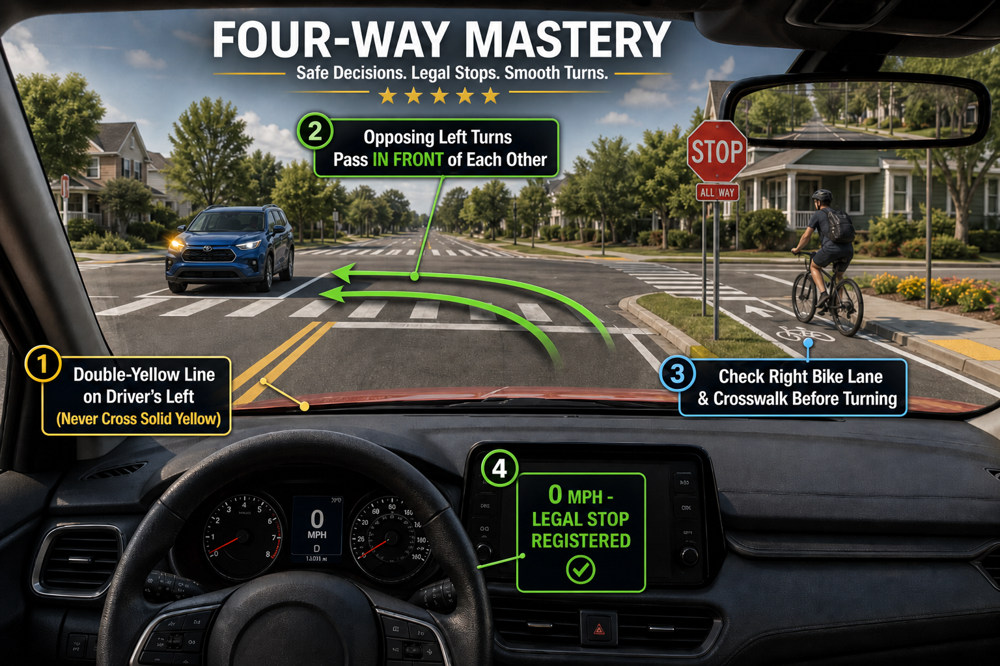
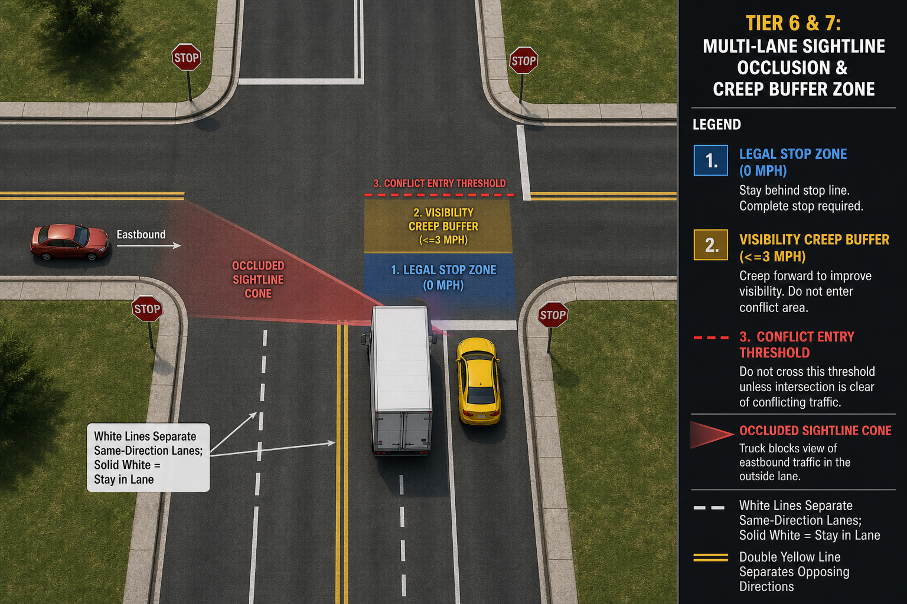
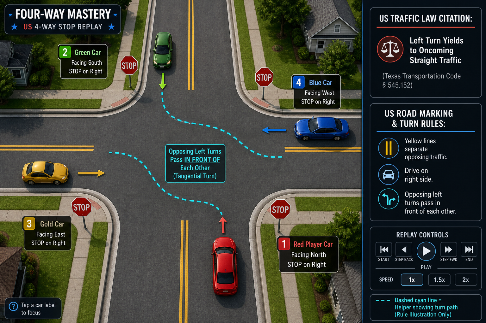

# US 4-Way Stop: Right-of-Way Mastery

A browser-based 3D traffic simulation and training game built with **Three.js**, **TypeScript**, and **Vite** to help international drivers and newcomers master **US 4-Way Stop (`ALL WAY`) intersections** and **US Right-Hand Traffic (RHT)** laws across 7 progressively harder tiers.

Grounded in the **Uniform Vehicle Code (UVC)** and the **U.S. Department of State Office of Foreign Missions (OFM) Driving Guide** (`docs/references/driving-practices-in-the-US.pdf`).

---

## Visual Overview

| 1st-Person LHD Cockpit POV | 3rd-Person Chase Cam & 3-Zone Bands | 3D Overhead Tactical Replay & OFM Citation |
| :---: | :---: | :---: |
|  |  |  |

---

## Key Features

### 1. Strict US Right-Hand Traffic (RHT) Geometry & Road Markings
- **Keep Right of the Double-Yellow Line:** All vehicles drive on the right-hand side of the central solid double-yellow divider (`South` leg on East half $x > 0$, `North` leg on West half $x < 0$, `West` leg on South half $z > 0$, `East` leg on North half $z < 0$).
- **Authentic US Signage & Striping:** Octagonal red **`STOP` + `ALL WAY`** signs mounted on the right-hand corner of every approach (`SE`, `NW`, `SW`, `NE`), white stop limit bars (`s = 0.0 m`) on approaching lanes only, broken/solid white same-direction lane dividers, continental zebra crosswalks, and green right-side bike lanes.
- **Tangential Near-Side Left Turns:** Opposing left-turning vehicles (`South → West` and `North → East`) turn **in front of each other** along non-intersecting cubic Bézier splines with $> 2.85\text{ m}$ separation, enabling legal concurrent progression.

### 2. 3-Zone Spatial Stop, Creep & Commit Controller
- **Zone 1 (`[-3.2m, +0.25m]` — Legal Stop Window):** Requires a full **`0.0 mph`** stop behind the white limit line to register your official stop timestamp ($T_{\text{stop}}$). Rolling through triggers a *"California Roll"* citation.
- **Zone 2 (`(0.0m, +1.5m]` — Visibility Creep Buffer):** After stopping in Zone 1, gently tap `[W]` to creep forward up to $+1.5\text{ m}$ at $\le 3.7\text{ mph}$ to peek past corner buildings or an adjacent **White Box Truck** without forfeiting your stop timestamp.
- **Zone 3 (`> +1.5m` — Conflict Box Entry):** Commits your vehicle to crossing or turning and evaluates your decision against the hierarchical US right-of-way engine.

### 3. 7-Tier Progressive Curriculum (14 Scenarios)
1. **Tier 1 — Complete Stop & First-to-Stop (FIFO):** Mandatory $0.0\text{ mph}$ stop at the limit line, FIFO queue order, and anti-piggybacking (stopping behind a lead car does not count as your stop at the limit line).
2. **Tier 2 — Simultaneous Arrivals & Yield-to-the-Right:** 2-car and 3-car simultaneous ties ($|\Delta t| \le 0.25\text{ s}$) resolved by yielding to the driver on your immediate right (*Farthest-Right Chain*).
3. **Tier 3 — Turn Signals & Opposing Traffic Conflicts:** Left turns yielding to opposing straight/right traffic, mutual opposing left turns passing in front of each other, and the **3-Car Simultaneous + Left-Turn Circular Deadlock Breaker**.
4. **Tier 4 — Vulnerable Road Users:** Yielding to pedestrians in entry/exit crosswalks and straight-through cyclists in the right-hand bike lane (*Anti-Right-Hook Rule*).
5. **Tier 5 — Emergency Vehicles & School Buses:** Active emergency responders (`AMBULANCE` / `POLICE` with sirens and strobe lightbars) overriding 4-way queues, and opposing US yellow **School Buses** with extended flashing red `STOP` arms.
6. **Tier 6 — Multi-Lane 4-Way Stops & Sightline Occlusion:** Proper approach lane selection (`[Q]` Inner Lane 0 for left turns vs. `[E]` Outer Curb Lane 1 for right turns) and creeping past adjacent `BOX_TRUCK` sightline blockers.
7. **Tier 7 — Real-World Defensive Driving Hazards:** Non-stopping *"California Roll"* runners, rain/fog windshield glare (`[F]` wipers/defogger), and the multi-lane **"Wave of Death"** courtesy-wave trap (`[H]` horn interaction).

### 4. U.S. Department of State OFM Point System & 60s Tactical Replay
- **OFM Moving Violation Ledger:** Tracks violation points across your session based on the official OFM point schedule:
  - *Driving through a stop sign / Passing a stopped school bus:* **3 points**
  - *Failure to yield at a posted sign:* **2 points**
  - *Improper turn / Improper lane:* **2 points**
  - Reaching **8 points** triggers an Administrative Review warning; **12 points** reaches the License Suspension threshold.
- **Interactive 60-Second 3D Overhead Tactical Replay:** On any violation (or on demand after passing), the camera transitions overhead with color-coded trajectory ribbons, a pulsing red conflict-point ring, stop-order timestamps (`#1`, `#2`, `TIE #1`), keyframe jump buttons, and automatic `2x` time-warping through stationary waits.

### 5. 3D Cartoon Vehicles, Multi-Camera Views & Accessibility
- **3D Cel-Shaded Cartoon Vehicles:** Extruded beveled 3D silhouettes with 4-band toon shading, spinning 5-spoke wheels, animated blinkers/brake lights/high-beam cones, and articulated walking pedestrians.
- **3 Camera Perspectives:**
  - **1st-Person US Left-Hand-Drive (LHD) Cockpit POV** (driver seated on the left at $x = -0.42\text{ m}$ with animated 3-spoke steering wheel, dashboard binnacle, and `Look Left [A]` / `Look Right [D]` head checks)
  - **3rd-Person Chase Camera (`[C]`)**
  - **3D Overhead Tactical Replay Camera**
- **Accessibility & Jurisdiction Settings (`⚙`):** Adjustable HUD Scale ($85\%\text{–}125\%$), Scrim Opacity, **Colorblind-Safe High-Contrast Mode** (Cyan / Gold / Magenta), Audio Mute (`[M]`), and a **US State Crosswalk Jurisdiction Selector** (*Universal US / UVC* vs. *California / Oregon Strict Full-Crosswalk Yield*).

---

## Controls

| Action | Keyboard | Mouse / Touch HUD |
| :--- | :--- | :--- |
| **Brake / Hold Complete Stop (`0.0 mph`)** | Hold `S`, `↓`, or `Space` | Hold **BRAKE** pedal |
| **Creep Forward (`≤ 3.7 mph`) / Accelerate** | Tap or Hold `W` or `↑` | Tap or Hold **CREEP / GO** pedal |
| **Head-Check Left (`-68°` Yaw)** | Hold `A` or `←` | Hold **◀ Look Left** |
| **Head-Check Right (`+68°` Yaw)** | Hold `D` or `→` | Hold **Look Right ▶** |
| **Select Inner Left Lane / Outer Right Lane (Tier 6)** | `Q` (Inner) / `E` (Outer) | Click **[Q] Inner** / **[E] Outer** pill |
| **Toggle Windshield Wipers & Defogger (Tier 7)** | `F` | Click **[F] Toggle Wipers** pill |
| **Sound Horn** | `H` | Click **HORN** button |
| **Toggle Cockpit POV / 3rd-Person Chase Cam** | `C` | Click **CAM** button |
| **Restart Current Scenario** | `R` | Click **↺ Retry [R]** |
| **Mute / Unmute Audio** | `M` | Click **🔊 Audio / 🔇 Muted** |
| **Pause / Quit Game & Session Summary** | `Esc` | Click **🚪 Quit [Esc]** |

---

## Getting Started

### Prerequisites
- **Node.js** `v18+` and **npm**

### Installation
```powershell
npm install
```

### Run in Development Mode
**Option A — Press `F5` in VS Code / Cursor:**
- Press **`F5`** (*Run US 4-Way Stop Game (Chrome)*). Cursor/VS Code will automatically start the Vite dev server and launch Chrome at `http://localhost:5173`.

**Option B — Terminal:**
```powershell
npm run dev
```
Then open **[http://localhost:5173](http://localhost:5173)** in your browser.

### Run Unit Tests
Runs the Vitest suite verifying US Right-Hand Traffic geometry, tangential opposing left-turn splines, FIFO & simultaneous right-side tiebreakers, 3-car deadlock resolution, OFM point citations, 60s replay buffer interpolation, and 3D cartoon vehicle generation:
```powershell
npm test
```

### Build for Production
```powershell
npm run build
npm run preview
```

---

## Project Structure

```text
traffic-game/
├── docs/
│   ├── PRD.md                        # Product Requirements Document (v1.3)
│   ├── handovers/                    # Session architecture & implementation handovers
│   ├── images/                       # Annotated HUD & camera concept renders
│   └── references/                   # U.S. Dept. of State OFM Driving Guide PDF
├── src/
│   ├── engine/
│   │   ├── types.ts                  # Core data contracts, zones, traits, and OFM types
│   │   ├── roadGeometry.ts           # US Right-Hand Traffic (RHT) coordinates & stop sign specs
│   │   ├── turnSplines.ts            # Cubic Bézier intersection splines & tangential left turns
│   │   ├── conflictGraph.ts          # Trajectory separation & concurrent shadowing analyzer
│   │   ├── stopSync.ts               # Dynamic AI Stop-Sync & perceptual deadband controller
│   │   ├── ruleEvaluator.ts          # Hierarchical US 4-way stop rule & OFM point evaluator
│   │   ├── scenarios.ts              # 7-Tier progressive curriculum catalog (14 scenarios)
│   │   ├── replayBuffer.ts           # 60-second ring buffer, keyframe tags & dead-air time-warp
│   │   ├── audio.ts                  # Procedural Web Audio synthesizer (blinker, chime, horn, alerts)
│   │   ├── simulation.ts             # Real-time 3-Zone kinematics & AI vehicle controller
│   │   └── __tests__/
│   │       └── trafficEngine.test.ts # Vitest unit test suite (12 test suites)
│   ├── render/
│   │   ├── vehicleFactory.ts         # 3D cel-shaded cartoon vehicles, spinning wheels & LHD cockpit
│   │   └── sceneManager.ts           # Three.js intersection environment, cameras & spatial badges
│   ├── ui/
│   │   ├── accessibilityStore.ts     # Persistent HUD scale, opacity, CVD mode & state law store
│   │   └── appUI.ts                  # 5-Stage UX state machine & 4-Layer HUD controller
│   ├── styles/
│   │   └── main.css                  # Safe-area HUD layout, local scrims & colorblind-safe styles
│   └── main.ts                       # Application entry point & input loop
├── index.html
├── package.json
├── tsconfig.json
└── vite.config.ts
```

---

## Disclaimer
*This application is an educational training simulator based on the Uniform Vehicle Code (UVC) and the U.S. Department of State Office of Foreign Missions (OFM) Driving Guide. Individual US state vehicle codes may vary; this software does not constitute official legal advice or state-certified driver licensing instruction.*
