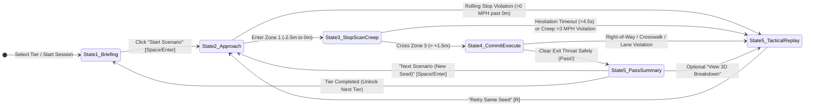

# Product Requirements Document — Four-Way Mastery (3D US Traffic Law Game) v1.3

**Company:** Personal / Independent Educational Game Project  ·  **Feature / Product:** Four-Way Mastery (3D US 4-Way Stop Simulator)
**Author:** Sean  ·  **Date created:** 2026-10-16  ·  **Last updated:** 2026-10-20  ·  **Version:** 1.3

*Confidential and subject to change. For internal use only. No external commitments can be made based on this document since it is in early planning stages. Content and timing are very likely to change.*

---

## 1. Overview of the Target Release

### Goal of This Release
Deliver a zero-install, browser-based 3D driving simulation game (**v1.0 Web MVP**) that teaches **international drivers and newcomers to the United States** how to confidently, legally, and safely navigate US 4-way stop intersections under **US Right-Hand Traffic (RHT)** rules. Players experience scenarios from a **Driver POV** (1st-person left-hand-drive cabin sitting in the right-hand lane, with head-checking plus a toggleable 3rd-person chase camera) in **real time**, using **rail-guided steering with manual lane selection (in multi-lane tiers), braking, head-checks, and acceleration**. As players demonstrate mastery, they level up through **7 structured difficulty tiers with randomized traffic seeds**—progressing from basic right-side lane orientation and two-car arrival order to simultaneous tiebreakers, left-turn conflicts, pedestrians/cyclists, emergency vehicles, multi-lane 4-way stops, and unpredictable real-world driver behavior. Every mistake triggers an **instant 3D visual replay** with a plain-English citation of the governing US traffic rule and **U.S. Department of State Office of Foreign Missions (OFM)** moving violation point equivalencies.

### Market Forces Driving This Release
- **Unique US Traffic Infrastructure & Right-Hand Traffic (RHT) Orientation:** Four-way (all-way) stop intersections are ubiquitous across North America but rare or nonexistent in most of the world (e.g., New Zealand, Australia, UK, Europe, Singapore, Japan), where roundabouts, priority roads, or traffic signals dominate. Furthermore, drivers arriving from left-hand traffic (LHT) countries must simultaneously adapt to driving on the **right side of the road** (with the double-yellow centerline on the driver's left) and turning into the correct right-hand receiving lane.
- **High Cognitive Load in Real-Time:** Studying static 2D diagrams in a state DMV handbook or the U.S. Department of State's *Driving Practices in the United States* guide (`docs/driving-practices-in-the-US.pdf`) does not prepare an international driver for the real-time spatial tracking required at a busy 4-way stop—remembering who stopped at the limit line first while checking crosswalks, turn signals, lane placement, and oncoming lanes.
- **Accessible Web-First 3D Technology:** Modern WebGL/WebGPU and Three.js allow instant, zero-install 3D training on desktop and mobile browsers before a newcomer rents a car at a US airport, applies for an OFM diplomatic or state driver's license, or sits for a road test.
- **Release Driver:** **Content-driven** (ship v1.0 when the core 7-tier progression, deterministic rule evaluator, US RHT lane/turn geometry validator, and instant replay explanation engine are complete and validated).

### Positioning Statement (≤25 words)
> For **international drivers in the US**, **Four-Way Mastery** **eliminates** **4-way stop hesitation, lane errors, and right-of-way mistakes** by **simulating real-time 3D intersections with instant rule feedback**.

### Product Description (≤50 words)
> **Four-Way Mastery** is a free-to-play 3D web game that trains international drivers to master US 4-way stop intersections. From the driver's seat in US right-hand traffic, players position in the proper lane, brake at the limit line, scan cross-traffic, and apply US right-of-way laws with instant visual replay feedback.

---

## 2. Personas

### Primary User Persona — "Relocating / Visiting International Driver" (Liam)
- **Profile:** Experienced licensed driver from outside North America (e.g., New Zealand, UK, Australia, Europe, or Asia), including expats, tourists, and foreign mission personnel covered by the U.S. Department of State OFM driver guidance (`docs/driving-practices-in-the-US.pdf`). Used to roundabouts, unambiguous give-way markings, and (frequently) driving on the left side of the road.
- **Goals:**
  - Build automatic, instinctive judgment at US 4-way stops—including staying on the **right side of the double-yellow centerline** and selecting the proper turn lane—before driving in live US traffic or taking a state DMV / OFM road test.
  - Understand both the *strict legal rules* (complete stop, FIFO, yield-to-the-right, straight-over-left, proper turn lanes) and *real-world defensive habits* (looking both ways before pulling away, handling wavers and rolling stops, no piggybacking).
  - Avoid accumulating moving violation points (e.g., under the OFM / state point system where **8 points in 2 years** triggers administrative review and **12 points** suspends driving privileges).
- **Behaviors & Current Workarounds:**
  - Reads state DMV PDF manuals, the OFM *Driving Practices in the United States* brochure, or watches YouTube videos showing top-down 2D animations.
  - Feels confident reading the rules on paper, but freezes or hesitates at real intersections because driver-seat perspective makes it harder to judge exact stop timestamps and receiving lanes across four corners.
- **Core Frustrations:**
  - Static multiple-choice DMV quizzes test memorization from a bird's-eye view ("Car A vs. Car B"), not real-time observation from behind the steering wheel.
  - Existing driving games focus on racing/parking physics rather than right-of-way rules, proper US lane discipline, and intersection decision-making.

### Secondary User / Referrer Persona — "Expat Mobility / OFM Orientation Coordinator" (Elena)
- **Profile:** Corporate relocation coordinator, foreign mission protocol officer, university international student advisor, or driving instructor helping newcomers transition to US roads.
- **Goals:** Share a free, zero-friction link that newcomers can complete on their laptop or phone to verify they understand US intersection right-of-way and right-side lane discipline before getting behind the wheel.

---

## 3. Market Problems (Persona's First-Person Voice, with Evidence)

> `[ASSUMPTION: Market evidence counts below are initial baseline estimates to be validated via user testing with international drivers (`n = 10–15` target interviews/playtests).]`

1. **Driver-Perspective Spatial Translation & Right-Side Lane Orientation Problem**
   - *"When I pull up to a 4-way stop in the US, I'm sitting on the left side of the cabin driving on the right side of the road (with the double-yellow line to my left). From the driver's seat, I struggle to track who stopped first across all four corners while also making sure I turn into the correct right-hand lane instead of drifting into the oncoming left lane."* — Evidence: `[ASSUMPTION: High prevalence among international newcomers from LHT countries; primary pedagogical gap in 2D DMV tests]`.
2. **Simultaneous Arrival & Multi-Rule Tiebreaker Confusion**
   - *"When two or three cars stop at the exact same moment and some of us are turning left while others are going straight, I freeze up because I don't know whether 'yield to the right' or 'left turn yields to straight' wins."* — Evidence: `[ASSUMPTION: Top cited point of confusion in US right-of-way forums and DMV practice exams]`.
3. **Habit Transfer Errors (Roundabout / Piggybacking / Rolling Stop Habits)**
   - *"Coming from a roundabout country, my muscle memory is to slow down, look for a gap, and roll through—or follow closely behind the car in front of me when it goes—and I don't realize that failing to make a fresh complete stop at the white line carries a 3-point Stop Sign violation in the US and causes T-bone collisions."* — Evidence: `docs/driving-practices-in-the-US.pdf` (p. 8: *Driving through a stop sign = 3 pts*; *Following too closely = 2 pts*; *Failure to yield at a posted sign = 2 pts*).
4. **Multi-Lane Placement & Sightline Occlusion Anxiety**
   - *"When I hit a suburban 4-way stop with two lanes in my direction, I'm not always sure which lane I must be in to turn left vs. right, and when a large truck stops in the lane next to me, I can't see cross-traffic or pedestrians stepping off the curb."* — Evidence: `docs/driving-practices-in-the-US.pdf` (p. 8: *Improper turns = 2 pts*; *Failure to keep in proper lane = 2 pts*).
5. **Real-World Ambiguity vs. Textbook Law ("Look Both Ways Before Pulling Away")**
   - *"Even when I know it's legally my turn, another driver sometimes rolls through without stopping, or someone who has the right-of-way flashes their lights and waves me on—and static quizzes never teach me to verify that cross-traffic is actually stopping before I pull out."* — Evidence: `docs/driving-practices-in-the-US.pdf` (p. 15, Safety Tip #2: *"Do not pull away from a sign or traffic light until you are sure other drivers are stopping or yielding"*).

---

## 4. Requirements (Grouped & Prioritized)

**Formula:** $\text{Priority} = \text{Market Evidence} \times \text{Impact}$  
*(Impact scale: 5 = minimum viability / core learning outcome, 4 = major user pain/safety impact, 3 = important progression depth, 2 = polish/secondary goal).*

### GROUP 1 — Core Real-Time Simulation, US Right-Hand Traffic Geometry & Controls
1. **Strict US Right-Hand Traffic (RHT) Road Markings, Lane Discipline & Turn Geometry (`REQ-01`)** — **Liam** becomes disoriented or learns wrong-way habits if road markings, stop signs, or vehicle lanes do not strictly follow US Right-Hand Traffic standards with **every scenario**.
   - *Specification (aligned with [Driving-Tests.org US Rules of the Road](https://driving-tests.org/beginner-drivers/rules-of-the-road/) & U.S. Dept. of State OFM Guide):*
     - **Steering Wheel & Road Side:** Steering wheels are always on the **left side** of the cabin, and vehicles always drive on the **right side** of the road.
     - **Yellow vs. White Line Semantics:**
       - **Yellow lines** separate traffic moving in **opposing directions**. Drivers must **never cross a solid yellow or double-yellow line**.
       - **White lines** separate lanes of traffic traveling in the **same direction**: **broken/hashed white lines** permit safe lane changes, while **solid white lines** (approaching the stop limit bar or marking a bike lane) require drivers to **stay in their lane**.
     - **Opposing Left Turns Pass IN FRONT OF Each Other (Tangential / Near-Side Turn):** When two opposing vehicles both turn left at an intersection, their paths pass **in front of each other** (driver-side to driver-side inside the center point of the intersection) rather than looping behind each other.
     - **Multi-Lane Keep-Right & Turn Lane Discipline:** In multi-lane scenarios (Tiers 6–7), the left-hand same-direction lane is the passing/left-turn lane and the right-hand lane is the normal travel/right-turn lane (do not pass on the right). Players must position in the **innermost right-side lane** (adjacent to the double-yellow line) for **Left Turns**, and the **outermost right-side lane** (adjacent to the right curb/bike lane) for **Right Turns**, checking for cyclists in the right bike lane before turning.
   - *Priority:* $25 \text{ (assumed evidence)} \times 5 \text{ (impact)} = \mathbf{125}$.
2. **Rail-Guided Approach with 3-Zone Stop / Creep / Commit Control (`REQ-02`)** — **Liam** has difficulty focusing on right-of-way rules when distracted by steering physics, or gets falsely penalized when creeping forward to see past an obstruction with **every scenario**.
   - *Specification:* The player's vehicle automatically steers along its legal US right-hand lane and turn trajectory. Speed/decision control operates across **three distinct spatial zones** at the intersection entry:
     1. **Zone 1 — Legal Stop Zone ($0\text{ to }-2.5\text{ m}$ behind the white limit line):** The player must brake to $0\text{ mph}$ here to register a legal stop.
     2. **Zone 2 — Visibility Creep Buffer ($0\text{ to }+1.5\text{ m}$ past the white limit line, prior to conflicting cross-traffic lanes):** Once a legal stop is registered in Zone 1, tapping/holding `W` creeps the car forward at $\le 3\text{ mph}$ so the player can peek past sightline obstructions *without* triggering a right-of-way violation.
     3. **Zone 3 — Conflict Entry Threshold ($> +1.5\text{ m}$ into the intersection box):** Crossing this line commits the vehicle to proceeding through the intersection and triggers the `REQ-05` Right-of-Way Evaluator.
   - *Priority:* $25 \times 5 = \mathbf{125}$.
3. **1st-Person LHD Cockpit with Head-Check + 3rd-Person Chase Toggle (`REQ-03`)** — **Liam** has trouble translating 2D bird's-eye handbook diagrams into real driver-seat scanning habits ("Look Left, Look Right, Look Left Again") with **every intersection approach**.
   - *Specification:* Default camera is a 1st-person driver-seat cockpit view positioned on the **left side of the vehicle cabin (US LHD)** while the car is in the **right-hand lane of the road (US RHT)**. Players pan/snap-look Left, Center, and Right (via `A`/`D` or `Q`/`E`, mouse drag, or touch buttons) to check cross-traffic and crosswalks, and can toggle to an elevated 3rd-person chase camera (`C` key / UI button).
   - *Priority:* $25 \times 5 = \mathbf{125}$.
4. **Real-Time Arrival with Dynamic Stop-Sync & Perceptual Deadband (`REQ-04`)** — **Liam** feels cheated if a manual braking difference of $0.05\text{ s}$ flips a perceived simultaneous tie into a FIFO violation with **every multi-car scenario**.
   - *Specification:*
     - A vehicle's arrival rank is recorded when its velocity reaches $0\text{ mph}$ inside Zone 1 (Legal Stop Zone).
     - **Dynamic Stop-Sync (Tiebreaker Seeds):** When a scenario seed is designed to test a *Simultaneous Arrival Tiebreaker* ($\Delta t \le 0.5\text{ s}$), AI vehicles subtly modulate their final braking over the last $3\text{ meters}$ to synchronize within $\Delta t \le 0.2\text{ s}$ of the player's stop.
     - **Perceptual Deadband (FIFO Seeds):** When a scenario seed tests *First-In, First-Out (FIFO)* order, AI arrival offsets are spaced so that $\Delta t \ge 1.2\text{ s}$, eliminating ambiguous $0.5\text{–}1.0\text{ s}$ edge cases.
   - *Priority:* $25 \times 5 = \mathbf{125}$.

### GROUP 2 — Deterministic US 4-Way Stop Rule & OFM Violation Engine
5. **Complete Stop, Proper Lane & Anti-Piggybacking Enforcement (`REQ-05`)** — **Liam** habitually rolls through slow intersections, turns from/into the wrong lane, or follows the car ahead without re-stopping with **high frequency during early practice**.
   - *Specification:* Grounded in the Uniform Vehicle Code (UVC) and U.S. Department of State OFM Point System (`docs/driving-practices-in-the-US.pdf`, p. 8), the engine detects and penalizes:
     - **Rolling Stop (*Driving through a stop sign — 3 OFM pts*):** Crossing the white limit line without reaching $0\text{ mph}$ in Zone 1, or exceeding $3\text{ mph}$ inside Zone 2 (Creep Buffer) while conflicting traffic has priority.
     - **Piggybacking (*Following too closely / Failure to yield — 2–3 OFM pts*):** Following a lead vehicle into the intersection without making a fresh $0\text{ mph}$ stop at the limit line and yielding to cross-traffic that stopped earlier.
     - **Improper Turn / Lane Violation (*Improper turn / Failure to keep in proper lane — 2 OFM pts*):** Initiating a left or right turn from the wrong multi-lane approach lane in Tiers 6–7.
   - *Priority:* $22 \times 5 = \mathbf{110}$.
6. **Hierarchical Right-of-Way, Conflict-Graph & Circular Deadlock Evaluator (`REQ-06`)** — **Liam** freezes when multiple right-of-way rules (3-car simultaneous stops + left turns + concurrent straight movements) interact simultaneously with **every intermediate and advanced scenario**.
   - *Specification:* Using the **Uniform Vehicle Code (UVC) & 50-State Defensive Consensus**, when the player crosses the Zone 3 **Conflict Entry Threshold**, the engine evaluates priority in strict order:
     1. **Emergency Vehicles & School Buses:** Approaching police/fire/ambulance with active sirens/lights (`Move Over / Yield Law`) and school buses with flashing red lights/stop arm extended have absolute priority over all approaches.
     2. **Pedestrians & Cyclists:** Pedestrians in marked or unmarked crosswalks and cyclists legally in conflicting lanes have priority over turning or crossing vehicles.
     3. **First-to-Stop (FIFO):** Vehicles with distinct stop timestamps ($\Delta t > 0.5\text{ s}$) proceed in stop-timestamp order, **subject to Concurrent Non-Conflicting Pass ("Shadowing"):** an opposing straight or right-turning vehicle whose path has **zero geometric conflict** with the active priority vehicle (and clear crosswalks) may legally proceed simultaneously without penalty.
     4. **2-Car / 3-Car Simultaneous Arrival ($\Delta t \le 0.5\text{ s}$) — Farthest-Right & Opposing Left-Turn Resolution:**
        - **Perpendicular Tie:** The driver on the left must yield to the driver on their **right** (the vehicle with an empty approach to its right holds rightmost positional priority).
        - **Opposing Tie:** A vehicle turning **left** must yield to an oncoming vehicle going **straight** or turning **right**.
        - **3-Car Simultaneous + Left-Turn Deadlock Breaker:** If three cars stop simultaneously (e.g., Southbound going Straight, Westbound going Straight, Northbound turning Left—where Northbound is rightmost of Westbound, Westbound is rightmost of Southbound, and Northbound turns left across Southbound), the **opposing straight vehicle (Southbound) proceeds first** to clear the left-turn conflict, followed by the **rightmost left-turning vehicle (Northbound)**, and finally the **perpendicular vehicle on the left (Westbound)**.
   - *Priority:* $25 \times 5 = \mathbf{125}$.
7. **Hazard-Aware Hesitation Detection (`REQ-07`)** — **Liam** waits indefinitely out of fear even when he legally has the right-of-way, but should never be penalized for waiting while a speeding hazard is running a stop sign with **moderate frequency**.
   - *Specification:* If the player legally has priority and the intersection is safe, waiting $> 4.5\text{ seconds}$ triggers a gentle courtesy horn and logs a "Hesitation / Right-of-Way Forfeiture" deduction. **Crucially, the hesitation timer automatically pauses** whenever any conflicting road user has a closing speed $> 2\text{ mph}$ without braking (e.g., Tier 7 Rolling Stoppers) or is inside the intersection conflict box.
   - *Priority:* $18 \times 4 = \mathbf{72}$.

### GROUP 3 — Progressive 7-Tier Curriculum & Procedural Scenario Generator
8. **Structured Mastery Tiers with Randomized Seeds (`REQ-08`)** — **Liam** memorizes static quiz answers ("let the blue car go") instead of internalizing the underlying traffic principle when replaying fixed levels with **every repeat session**.
   - *Specification:* Organize progression into **7 progressive Difficulty Tiers** (Section 12.2). Each tier introduces specific rule mechanics and generates randomized scenarios (varying approach directions, vehicle models/colors, arrival offsets, weather/lighting, and turn intentions) while guaranteeing each seed tests the target rule of that tier.
   - *Priority:* $20 \times 5 = \mathbf{100}$.
9. **Multi-Lane, Pedestrian/Cyclist, Emergency, Weather & Unpredictable AI Modifiers (`REQ-09`)** — **Liam** is caught off-guard when real intersections add multiple lanes, vulnerable road users, emergency vehicles, rain/fog visibility, or rule-breaking drivers with **advanced scenarios**.
   - *Specification:* Progressive tiers systematically introduce:
     - **Pedestrians & Cyclists (Tier 4):** Crosswalk walkers and bike-lane/roadway cyclists (including a state-law note on cyclist "Stop-as-Yield / Safety Stop" states).
     - **Emergency Vehicles & School Buses (Tier 5):** Spatial audio sirens and school bus flashing red lights.
     - **Multi-Lane 4-Way Stops & Sightline Occlusion (Tier 6):** 2 lanes per direction (Left-Turn/Straight inner lane + Straight/Right-Turn outer curb lane) with large box trucks/SUVs requiring Zone 2 Creep Buffer peeking.
     - **Real-World Hazards, Weather & "Wave of Death" Traps (Tier 7):** Incorporates OFM Safety Tips (`docs/driving-practices-in-the-US.pdf`, pp. 15–16): rain/fog requiring headlights & longer braking distances, *Rolling Stoppers* (verifying cross-traffic is actually stopping before pulling out), single-lane *Polite Headlight Wavers*, and the **"Multi-Lane Wave Trap"** (where a stopped driver in the near lane waves the player through while a second vehicle speeds past in the far lane).
   - *Priority:* $20 \times 4 = \mathbf{80}$.

### GROUP 4 — Instant Visual Replay, Adaptive HUD/UX & Pedagogical Feedback
10. **Full-Lifecycle 3D Tactical Replay & OFM/UVC Rule Citation Overlay (`REQ-10`)** — **Liam** does not understand *why* he failed a scenario when a simulation simply says "Game Over" or cuts off the initial stop order with **every mistake**.
    - *Specification:* Record the **entire scenario lifecycle** (up to $60\text{ s}$ at $20\text{ Hz}$) with keyframe markers (`Stop #1`, `Stop #2`, `Conflict Entry`) and auto-time-warp scrubbing. On any violation, transition to an **Elevated Tactical Overhead Replay** displaying:
      - Floating stop-order badges (`#1 - Stopped at 1.4s`, `TIE - Rightmost Priority`), lane markings (highlighting the double-yellow centerline on the left of each approach), and trajectory ribbons.
      - **US Traffic Law Citation Card:** Plain-English UVC rule, **OFM Moving Violation Point Penalty** (e.g., *Driving through a stop sign: 3 pts*; *Failure to yield: 2 pts*; *Improper turn: 2 pts*), **State Law Variation Note** (where applicable), and an **International Driver Tip**.
    - *Priority:* $24 \times 5 = \mathbf{120}$.
11. **Star / Mastery Rating, Driving Record Tracker & Browser Persistence (`REQ-11`)** — **Liam** wants to track which US 4-way stop rules he has mastered and keep his virtual OFM/DMV driving record below the 8-point review / 12-point suspension threshold across sessions with **every session**.
    - *Specification:* Award 0–3 Stars per scenario based on: (1) Legal $0\text{ mph}$ stop in Zone 1 + proper US right-side lane placement, (2) Correct right-of-way / defensive decision without collision, and (3) Complete left-right-left head-checks and timely execution. Persist progress in `localStorage`.
    - *Priority:* $16 \times 3 = \mathbf{48}$.
12. **Immersion-Preserving Adaptive HUD & Context-Driven UX Flow (`REQ-12`)** — **Liam** experiences cognitive overload or missed visual cues if screen overlays obscure the windshield horizon or require taking his eyes off approaching cross-traffic with **every scenario**.
    - *Specification:* Grounded in Game UX cognitive science (Hodent, 2017; Fagerholt & Lorentzon's 4-Quadrant HUD Taxonomy), the interface must:
      - Keep the **central foveal windshield zone (inner $60\%$ of the viewport) $100\%$ free of persistent 2D UI**, anchoring HUD clusters to runtime `safe-area-inset` edges within a $16:9$ inner frame.
      - Combine **Diegetic** (in-cabin speedometer, blinker indicators, mirror views, exterior vehicle brake nose-dive), **Spatial** (road-projected turn chevrons, 3-Zone pavement bands, floating arrival badges), **Meta** (A-pillar off-screen siren/hazard glow, windshield rain/fog), and **Non-Diegetic** (high-contrast scrim-backed HUD clusters with tabular numerals and colorblind-safe redundant icons) layers.
      - Enforce **Contextual State Swaps & Onboarding Decay**: automatically surface controls only during the phase they apply (e.g., lane-selection `[Q]`/`[E]` only at $50\text{–}20\text{ m}$; Zone 2 Creep gauge only after a legal stop in Zone 1), fade out floating arrival-number training wheels after Tier 2, and execute total instant HUD context swaps between Active Driving and Tactical Replay.
    - *Priority:* $22 \times 5 = \mathbf{110}$.

---

## 5. Use Scenarios (Day-in-the-Life)

### Scenario A — The First-Time US Rental Car / OFM License Prep (Right-Side Lane & Anti-Piggybacking)
**Liam** has just arrived in the US from New Zealand and opens **Four-Way Mastery** in his browser. In **Tier 1**, he sits in the left-hand driver seat while his car approaches in the **right-hand lane** (double-yellow centerline on his left, `STOP / ALL WAY` sign on his right curb) behind a silver sedan. When the silver sedan stops and then accelerates through the intersection, Liam's roundabout muscle memory tempts him to follow right behind it without re-stopping. As he crosses the white limit line at $11\text{ mph}$, the simulation freezes before a cross-traffic pickup (approaching from the right on its own right-hand side of the road) collides with him. The **Tactical Overhead Replay** highlights the pickup's stop timestamp ($T = 1.8\text{ s}$) and cites: *"US Rule — Mandatory Complete Stop & No Piggybacking (OFM Moving Violation: Driving through a stop sign = 3 pts; Failure to yield = 2 pts). Each vehicle must come to its own complete 0 MPH stop behind the white limit line."* On retry, Liam stops at $0\text{ mph}$ in Zone 1, checks left-right-left, lets the pickup clear, and proceeds for 3 stars.

### Scenario B — The 3-Way Simultaneous Tiebreaker + Left Turn Deadlock Breaker
In **Tier 3**, **Liam** approaches northbound (in the bottom-right lane, to the right of the double-yellow line) with a mission to **Turn Left**. Due to Dynamic Stop-Sync (`REQ-04`), three vehicles stop simultaneously ($\Delta t = 0.15\text{ s}$):
- **Liam (Northbound, South leg):** Turning **Left** (West). The East leg to Liam's right is empty.
- **Green Car (Southbound, North leg, in its right-hand/west lane facing South):** Going **Straight** (South).
- **Gold Car (Eastbound, West leg, in its right-hand/south lane facing East):** Going **Straight** (East).
Liam checks left and right from the cockpit camera and reasons through the **3-Car Simultaneous + Left-Turn Rule (`REQ-06`)**:
1. Gold Car (on Liam's left) must yield to Liam (to its right).
2. However, Liam is turning **left** across the path of the oncoming Green Car going **straight**.
3. Therefore, the **oncoming straight Green Car proceeds first** to break the circle; **Liam turns left second** (into the proper right-hand westbound exit lane, staying south/right of the cross-street's double-yellow line); and **Gold Car goes third**.
Liam waits for the Green Car to pass, executes his left turn cleanly before the Gold Car, and earns 3 stars.

### Scenario C — Multi-Lane Sightline Occlusion & The Visibility Creep Buffer
In **Tier 6 & 7**, **Liam** approaches northbound on a 4-lane road (two southbound lanes to the left of the double-yellow line; two northbound lanes to the right of the double-yellow line). Liam is in the **outermost right-hand lane** going straight, while a tall **White Box Truck** is stopped to his immediate left in the **innermost northbound left-turn lane**, completely blocking Liam's view of eastbound cross-traffic approaching from the left.
1. Liam first comes to a complete $0\text{ mph}$ stop behind the white limit line in **Zone 1 (Legal Stop Zone)**.
2. Recognizing the red **Occluded Sightline Cone**, Liam lightly taps `W` to ease forward at $2.5\text{ mph}$ into **Zone 2 (Visibility Creep Buffer, $0\text{ to }+1.5\text{ m}$)** while holding short of the **Zone 3 Conflict Entry Threshold**.
3. Peeking past the box truck's bumper with `Look Left [A]`, Liam spots a distracted red sedan blowing through the left stop sign at $35\text{ mph}$ in the near eastbound lane. Liam holds the brake, lets the hazard pass safely, and earns a **"Defensive Driving Save!"** badge (aligning with OFM Safety Tip #2: *Never pull away from a sign until you are sure other drivers are stopping*).

---

## 6. Requirements Summary

| ID | Requirement | Persona | Market Evidence (Assumed) | Impact (1–5) | Priority | Group | Group Order |
| :--- | :--- | :--- | ---: | ---: | ---: | :--- | ---: |
| `REQ-01` | Strict US Right-Hand Traffic (RHT) Road & Lane Geometry | Liam | 25 | 5 | **125** | Group 1: Core Simulation | 1 |
| `REQ-02` | Rail-Guided Approach with 3-Zone Stop / Creep / Commit Control | Liam | 25 | 5 | **125** | Group 1: Core Simulation | 2 |
| `REQ-03` | 1st-Person LHD Cockpit (Head-Check) + 3rd-Person Chase Toggle | Liam | 25 | 5 | **125** | Group 1: Core Simulation | 3 |
| `REQ-04` | Real-Time Arrival with Dynamic Stop-Sync & Perceptual Deadband | Liam | 25 | 5 | **125** | Group 1: Core Simulation | 4 |
| `REQ-06` | Hierarchical Right-of-Way, Conflict-Graph & Deadlock Evaluator | Liam | 25 | 5 | **125** | Group 2: Rule Engine | 1 |
| `REQ-10` | Full-Lifecycle 3D Tactical Replay & OFM/UVC Rule Citation Overlay | Liam | 24 | 5 | **120** | Group 4: HUD, UX & Feedback | 1 |
| `REQ-05` | Complete Stop, Proper Lane & Anti-Piggybacking Enforcement | Liam | 22 | 5 | **110** | Group 2: Rule Engine | 2 |
| `REQ-12` | Immersion-Preserving Adaptive HUD & Context-Driven UX Flow | Liam | 22 | 5 | **110** | Group 4: HUD, UX & Feedback | 2 |
| `REQ-08` | Structured 7-Tier Curriculum with Randomized Seeds | Liam | 20 | 5 | **100** | Group 3: Curriculum | 1 |
| `REQ-09` | Pedestrians, Cyclists, Emergency, Multi-Lane, Weather & Hazard AI | Liam | 20 | 4 | **80** | Group 3: Curriculum | 2 |
| `REQ-07` | Hazard-Aware Hesitation Detection | Liam | 18 | 4 | **72** | Group 2: Rule Engine | 3 |
| `REQ-11` | Star / Mastery Rating, OFM Point Tracker & Browser Persistence | Liam | 16 | 3 | **48** | Group 4: HUD, UX & Feedback | 3 |

---

## 7. Out of Scope / Non-Goals (v1.0)

- **Full Open-World City Driving or Parking Enforcement:** Players do not parallel park or navigate highway interchanges; every scenario focuses on the final $50\text{ meters}$ approaching and clearing a 4-way stop intersection.
- **Traffic Light, Roundabout, or Uncontrolled/2-Way Stop Intersections:** v1.0 focuses exclusively on mastering **4-way / all-way stop** intersections (2-way stop cross-traffic is reserved for v2.0).
- **Multiplayer Networking or Backend Accounts:** All gameplay is single-player against deterministic/behavioral AI, with progression stored locally in `localStorage`.
- **Legal Advice or Official DMV Certification:** The game includes a clear educational disclaimer stating that it teaches the Uniform Vehicle Code (UVC) and U.S. Department of State OFM defensive consensus and is not a substitute for an official state DMV driver's handbook.

---

## 8. Success Metrics

| Metric Category | Metric | Current Baseline | v1.0 Target Goal |
| :--- | :--- | :--- | :--- |
| **Value (Learning Efficacy)** | Reduction in right-of-way & wrong-lane errors from Tier 1 to Tier 6+ | N/A (New Product) | $\ge 35\%$ reduction in errors after 15 minutes of play |
| **Quality (Simulation & Accuracy)** | Browser frame rate, US RHT lane geometry compliance, & rule accuracy | N/A | $\ge 60\text{ FPS}$; $100\%$ unit-tested deterministic rule & RHT lane accuracy |
| **Progress (Completion Depth)** | % of players who complete at least Tier 4 without hitting 8 OFM violation points | N/A | $\ge 50\%$ of active session starts reach Tier 4 |
| **Satisfaction** | Post-tier player self-reported confidence rating ("Do you feel clearer on US 4-way stops?") | N/A | $\ge 4.3 / 5.0$ average rating |

---

## 9. Dependencies, Risks & Mitigations

| # | Risk / Issue Identified | Impact | Concrete Mitigation Built into Specification | Linked Requirements & Spec Sections |
| :---: | :--- | :---: | :--- | :--- |
| **1** | **Right-Hand Traffic (RHT) vs. Left-Hand Drive (LHD) Confusion** — International drivers from LHT countries (NZ, AU, UK, JP, SG) may confuse left-hand steering wheel position with driving on the left side of the road, cross solid yellow lines, or turn into the oncoming left lane. | Critical | Strictly enforce US RHT road & marking geometry across all 3D scenes, UI minimaps, and concept art: steering wheel on the **left**, vehicles on the **right side** of the central solid double-yellow line (yellow separates opposing traffic; white separates same-direction traffic; solid white = stay in lane), stop bars/signs on the **right**, and opposing left turns passing **in front of each other** (tangential turn). | `REQ-01`, `REQ-05`, Section 12.1, Section 12.3 |
| **2** | **3-Car Simultaneous + Left-Turn Circular Deadlock** — In a 3-car simultaneous stop where the rightmost car is turning left across an opposing straight car, pure "yield to right" + "left yields to straight" creates a circular Rock-Paper-Scissors loop (`Northbound yields to Southbound` $\rightarrow$ `Southbound yields to Eastbound` $\rightarrow$ `Eastbound yields to Northbound`). | High | Define a deterministic **3-Car Simultaneous + Left-Turn Deadlock Breaker**: when the unconstrained rightmost vehicle is turning left across an opposing straight/right-turning vehicle, the **opposing straight/right-turning vehicle proceeds first** (breaking the conflict cycle), followed immediately by the **rightmost left-turning vehicle**, and finally the **perpendicular vehicle on the left**. | `REQ-06` (Rule 4c), Scenario B (Section 5), Section 12.5 |
| **3** | **The "0.51-Second Trap" in Manual Braking** — Because braking is manual, a player stopping at $0.55\text{ s}$ after a perpendicular car crosses the $\Delta t = 0.5\text{ s}$ simultaneous threshold and fails for violating FIFO even though a human driver perceives a simultaneous tie. | High | Implement **Dynamic AI Stop-Sync** ($\Delta t \le 0.2\text{ s}$ braking modulation over the final $3\text{ m}$ on simultaneous tiebreaker seeds) and a **Perceptual Deadband** ($\Delta t \ge 1.2\text{ s}$ minimum arrival separation on FIFO seeds) so no scenario ever falls into the ambiguous $0.5\text{–}1.0\text{ s}$ gray zone. | `REQ-04`, Section 12.5 |
| **4** | **Input Collision Between "Creep Forward" and "Proceed"** — Using `W` / `Up Arrow` to peek past a sightline-occluding truck in Tiers 6–7 would falsely trigger a right-of-way violation if evaluated at the white limit line. | High | Implement the **3-Zone Spatial Entry Model**: **Zone 1 (`Legal Stop Zone`, $0\text{ to }-2.5\text{ m}$)** requires a $0\text{ mph}$ stop; **Zone 2 (`Visibility Creep Buffer`, $0\text{ to }+1.5\text{ m}$ past the stop bar)** allows safe creeping at $\le 3\text{ mph}$ without triggering a right-of-way check; **Zone 3 (`Conflict Entry Threshold`, $> +1.5\text{ m}$)** commits the vehicle and triggers `REQ-06`. | `REQ-02`, Scenario C (Section 5), Concept 3, Section 12.4 |
| **5** | **Concurrent Non-Conflicting Movements ("Shadowing")** — Strictly enforcing single-file FIFO when 4 cars are stopped penalizes a player who safely proceeds straight alongside an opposing priority vehicle going straight while cross-traffic is already blocked. | Medium | Evaluate a **Geometric Conflict Graph** in the rule engine: an opposing straight or right-turning vehicle whose trajectory has **zero geometric conflict** with the active priority vehicle (and clear crosswalks/bike lanes) is granted a **Concurrent Pass Allowance** to proceed simultaneously without penalty. | `REQ-06` (Rule 3), Section 12.5 |
| **6** | **12-Second Replay Truncation in Complex Tiers** — In Tiers 4–7 (multi-lane queues, slow pedestrians, emergency vehicles), the initial stops ($T_1, T_2$) happen $15\text{–}25\text{ s}$ before the conflict, so a 12-second rolling buffer cuts off the proof of who stopped first. | Medium | Record the **full scenario lifecycle** from spawn to outcome (capped at $60\text{ s}$ at $20\text{ Hz}$, $\sim 90\text{ KB}$) and provide **Keyframe Scrubbing & Auto-Time-Warp** (`1x` during stops, `2.5x` through dead wait time, `0.5x` at conflict entry). | `REQ-10`, Concept 2, Section 12.5 |
| **7** | **Hesitation Penalty During Rolling-Stop Hazards & "Wave of Death" Ambiguity** — Waiting for a speeding hazard to pass could accidentally trigger the $4.5\text{ s}$ hesitation penalty; blindly accepting a wave in multi-lane traffic causes collisions. | High | Make the **Hesitation Timer Hazard-Aware** (pausing whenever any conflicting vehicle has closing speed $> 2\text{ mph}$ without braking or is in the conflict box), and include the **"Multi-Lane Wave Trap"** in Tier 7 to teach verifying all lanes before accepting a headlight wave. | `REQ-07`, `REQ-09`, Section 12.2, Section 12.5 |
| **8** | **Stop-Order Ambiguity from 1st-Person Perspective on a Flat Monitor** — Judging subtle braking completion across 4 approaches from a single-screen cockpit view can be difficult in early tiers. | Medium | Slightly exaggerate vehicle pitch/nose-dive upon $0\text{ mph}$ stop registration, render high-contrast stop bars, show optional arrival-order training badges in Tiers 1–2 (fading out in Tiers 3+), and allow instant `C`-key toggle to the 3rd-person chase camera. | `REQ-03`, `REQ-04`, Concept 1 |
| **9** | **Mobile vs. Desktop Input Ergonomics in Web 3D** — Simultaneously head-checking and controlling pedals on touchscreens can feel cramped if controls require manual steering. | Medium | Use rail-guided steering (`REQ-02`) with dedicated touch buttons for `Hold Brake`, `Creep / Go`, `Camera [C]`, and quick-glance `Look Left [A]` / `Look Right [D]` toggles. | `REQ-02`, `REQ-03`, Section 12.4 |
| **10** | **US State-by-State Legal Variations & Liability Disclaimer** — Cyclist stop rules ("Idaho Stop / Safety Stop") and school bus divided-highway rules vary across the 50 states. | Low | Establish the **Uniform Vehicle Code (UVC) + U.S. Dept. of State OFM Guide + 50-State Defensive Consensus** as the canonical baseline, include a *"State Law Variation Note"* on Rule Citation Cards, and display a standard educational disclaimer. | `REQ-06`, `REQ-10`, Section 7, Section 12.5 |

---

## 10. Approvals

| Name | Title | Date | Signature |
| :--- | :--- | :--- | :--- |
| Sean | Product Owner / Author | 2026-10-20 | *Pending Review* |

---

## 11. Change Tracking

| Version | Date | Changes | Reason |
| :--- | :--- | :--- | :--- |
| 1.0 | 2026-10-16 | Initial comprehensive PRD and game design specification | Product definition & discovery refined via Q&A |
| 1.1 | 2026-10-19 | Added strict US Right-Hand Traffic (RHT) lane/turn rules, U.S. Dept. of State OFM violation point system (`docs/driving-practices-in-the-US.pdf`), and initial risk mitigations | PRD risk review & US traffic law alignment |
| 1.2 | 2026-10-20 | Incorporated [Driving-Tests.org US Rules of the Road](https://driving-tests.org/beginner-drivers/rules-of-the-road/) (yellow/white line rules, opposing tangential left turns passing in front of each other, right bike lane checks, emergency-only horn etiquette), updated all 3 visual concept images, and added Section 12.5 (Engineering Implementation Plan for Risk Mitigations) | Full alignment of PRD, concept art, and risk mitigation implementation plan |
| 1.3 | 2026-10-20 | Added `REQ-12` and expanded Section 12.4 to specify Game HUD & UX Architecture (Diegetic/Spatial/Meta/Non-Diegetic taxonomy, cognitive load & peripheral vision principles, adaptive visibility & onboarding decay, accessibility/scrim standards, and the 5-stage Player Interaction Flow state machine) | Web UX/HUD research synthesis applied to product specification |

---

## 12. Game Design, Visual Concepts & Functional Specification Appendix

### 12.1 Annotated Visual Design Concepts

All visual designs strictly depict **US Right-Hand Traffic (RHT)** and the road-marking rules from [Driving-Tests.org US Rules of the Road](https://driving-tests.org/beginner-drivers/rules-of-the-road/): every vehicle approaches in the lane(s) to the **right** of the central double-yellow line, with `STOP / ALL WAY` signs on the right-hand curb, white lines separating same-direction lanes, and opposing left turns passing in front of each other.

#### Concept 1 — 1st-Person Cockpit POV & HUD (`docs/images/concept-1-cockpit-pov-hud.png`)
- **File:** `C:\Users\slowcay\Documents\Code\traffic-game\docs\images\concept-1-cockpit-pov-hud.png`
- **Key Visual & Pedagogical Elements:**
  1. **Callout 1 — Double-Yellow Line on Driver's Left (`Never Cross Solid Yellow`):** Reinforces US right-hand lane positioning from a left-hand steering wheel cabin.
  2. **Callout 2 — Opposing Left Turns Pass IN FRONT OF Each Other:** Shows the oncoming Blue SUV stopped behind its opposing limit line (screen-left) with green curved trajectory arrows demonstrating how two opposing left-turning vehicles pass **in front of each other** (tangential turn) without crossing paths.
  3. **Callout 3 — Check Right Bike Lane & Crosswalk Before Turning:** Highlights a dedicated bicycle lane on the right curb with a cyclist, reinforcing the US rule to always check bike lanes and crosswalks before turning.
  4. **Callout 4 — Dashboard `0 MPH - LEGAL STOP REGISTERED`:** Confirms a complete stop behind the white stop bar.

#### Concept 2 — Instant 3D Overhead Tactical Replay & Rule Citation (`docs/images/concept-2-tactical-replay-citation.png`)
- **File:** `C:\Users\slowcay\Documents\Code\traffic-game\docs\images\concept-2-tactical-replay-citation.png`
- **Key Visual & Pedagogical Elements:**
  1. **Strict US Right-Side Lane Placement Across All 4 Approaches:**
     - **1. Red Player Car (Bottom road, Northbound):** On the right (East) side of the double-yellow line, with its `STOP` sign on the bottom-right corner.
     - **2. Green Car (Top road, Southbound):** On the right (West) side of the double-yellow line, with its `STOP` sign on the top-left corner.
     - **3. Gold Car (Left road, Eastbound):** On the right (South) side of the double-yellow line, with its `STOP` sign on the bottom-left corner.
     - **4. Blue Car (Right road, Westbound):** On the right (North) side of the double-yellow line, with its `STOP` sign on the top-right corner.
  2. **Opposing Left Turns Pass IN FRONT OF Each Other (Tangential Turn):** Dashed cyan helper curves in the center of the intersection illustrate simultaneous opposing left turns passing in front of each other.
  3. **US Traffic Law Citation & Road Marking Rules Card:** Summarizes *Left Turn Yields to Oncoming Straight Traffic*, *Yellow lines separate opposing traffic*, *Drive on right side*, and *Opposing left turns pass in front of each other*.

#### Concept 3 — Tier 6 & 7 Multi-Lane Sightline Occlusion & 3-Zone Creep Buffer (`docs/images/concept-3-chase-cam-creep-zones.png`)
- **File:** `C:\Users\slowcay\Documents\Code\traffic-game\docs\images\concept-3-chase-cam-creep-zones.png`
- **Key Visual & Pedagogical Elements:**
  1. **US Road Line Semantics Annotated on Pavement:**
     - **Double-Yellow Line:** *"Separates Opposing Directions."*
     - **Dashed White Line:** *"White Lines Separate Same-Direction Lanes (may change lanes when safe)."*
     - **Solid White Line (near intersection):** *"Solid White = Stay in Lane."*
  2. **Multi-Lane Right-Hand Traffic & Eastbound Cross-Traffic:** The **White Box Truck** (inner northbound lane) and **Yellow Player Car** (outermost right-side northbound lane) are stopped to the right of the vertical double-yellow line. On the horizontal road, the **Red Eastbound Car** travels left-to-right in the lower (South/right-hand) lane, partially hidden by the red **Occluded Sightline Cone**.
  3. **Three Spatial Control Zones:**
     - **Zone 1 (Blue) — `LEGAL STOP ZONE (0 MPH)`:** Stay behind stop line; complete stop required.
     - **Zone 2 (Yellow) — `VISIBILITY CREEP BUFFER (<= 3 MPH)`:** Creep forward to improve visibility without entering the conflict area.
     - **Zone 3 (Red Dashed Line) — `CONFLICT ENTRY THRESHOLD`:** Do not cross unless the intersection is clear of conflicting traffic.

---

### 12.2 The 7-Tier Difficulty Progression Curriculum

Each tier consists of **5 randomized scenarios** (requiring $4/5$ clean passes and $< 8$ cumulative OFM violation points across the tier to unlock the next tier), starting with a 15-second interactive rule & US lane orientation briefing card.

| Tier | Tier Name | New Mechanics Introduced | Active Road Users | Target US Traffic Rule & OFM Practice Taught |
| :---: | :--- | :--- | :--- | :--- |
| **Tier 1** | **US Right-Side Orientation, Complete Stop & FIFO** | Single-lane 4-way stop; US Right-Hand Traffic orientation (double-yellow line on driver's left); distinct arrival times ($\Delta t \ge 1.2\text{ s}$); queued lead car (anti-piggybacking). | 2–3 cars | Drive on the right side of the road; mandatory $0\text{ mph}$ stop in Zone 1 (*Stop sign violation = 3 OFM pts*); no piggybacking behind lead car (*Following too closely / Failure to yield = 2 pts*). |
| **Tier 2** | **Simultaneous Arrivals: Yield to the Right** | Two or three perpendicular vehicles stopping within $\Delta t \le 0.2\text{ s}$ (via Dynamic Stop-Sync); straight movements. | 2–3 cars | When stopping simultaneously, the driver on the left must yield to the driver on their **right** (farthest-right cascade). |
| **Tier 3** | **Turn Signals, Receiving Lanes & Opposing Conflicts** | Left and right turn intentions; opposing cars stopping simultaneously; 3-car simultaneous + left-turn deadlock breaker; concurrent straight shadowing. | 2–4 cars | Left-turning drivers must yield to oncoming straight or right-turning traffic and turn into the proper right-hand lane to the right of the cross-street's yellow centerline (*Improper turn = 2 OFM pts*). |
| **Tier 4** | **Pedestrians & Cyclists (Vulnerable Road Users)** | Crosswalk pedestrians (entering from left/right sidewalks) and cyclists in bike lanes or right-hand traffic lanes. | 2–3 cars + 1–2 pedestrians/cyclists | Pedestrians in marked/unmarked crosswalks always have priority; cyclists at stop signs have full vehicle priority (with state-law note on "Safety Stop" states); mandatory head-checks before turning. |
| **Tier 5** | **Emergency Vehicles & School Buses** | Approaching police/ambulance/fire trucks with sirens & lights; school buses with flashing amber/red lights and stop arms (`Move Over / Yield Laws`). | 2–4 cars + 1 emergency vehicle or school bus | Absolute priority override: remain stopped until emergency vehicles clear or school bus retracts its red stop arm. |
| **Tier 6** | **Multi-Lane 4-Way Stops & Sightline Occlusion** | 2 lanes per direction (Inner lane = Left Turn/Straight; Outer curb lane = Straight/Right Turn); pre-intersection lane selection; box trucks blocking side visibility; Zone 2 Creep Buffer. | 4–6 cars + pedestrians | Approach in the proper lane for your turn (*Failure to keep in proper lane = 2 OFM pts*); stop in Zone 1, then creep at $\le 3\text{ mph}$ in Zone 2 to clear sightline obstructions before crossing Zone 3. |
| **Tier 7** | **Real-World Hazards, Weather & Defensive Mastery** | Unpredictable AI & adverse conditions (OFM Safety Tips #1–#3): rain/fog requiring headlights & longer braking; *Rolling Stoppers*; *Polite Wavers*; and the *Multi-Lane Wave Trap*. | 3–6 mixed road users | *"Do not pull away from a sign until you are sure other drivers are stopping"* (OFM p. 15); never blindly trust a wave across multiple lanes; turn headlights on when wipers are in use. |

---

### 12.3 US Right-Hand Traffic (RHT) Coordinate & Lane Specification (For 3D Engine)

To ensure zero ambiguity when building the Three.js intersection and AI pathing:

| Approach Leg | Travel Direction | Heading Angle | Approaching Lanes (US Right Side of Centerline) | Opposing / Exit Lanes (Left Side of Centerline) | Stop Sign & Limit Line Placement |
| :--- | :--- | :---: | :--- | :--- | :--- |
| **South Leg** | **Northbound** (`+Y` / `-Z`) | $0^\circ$ (Up) | **East half of road** ($x > 0$): • Inner Lane: $x \in [0, +3.5\text{ m}]$ (Left Turn / Straight) • Outer Curb Lane: $x \in [+3.5, +7.0\text{ m}]$ (Straight / Right Turn) | **West half of road** ($x < 0$) | SE Corner curb ($x > 0$); white limit line spans $x \in [0, +7.0\text{ m}]$ only. |
| **North Leg** | **Southbound** (`-Y` / `+Z`) | $180^\circ$ (Down) | **West half of road** ($x < 0$): • Inner Lane: $x \in [-3.5, 0\text{ m}]$ • Outer Curb Lane: $x \in [-7.0, -3.5\text{ m}]$ | **East half of road** ($x > 0$) | NW Corner curb ($x < 0$); white limit line spans $x \in [-7.0, 0\text{ m}]$ only. |
| **West Leg** | **Eastbound** (`+X`) | $90^\circ$ (Right) | **South half of road** ($z > 0$): • Inner Lane: $z \in [0, +3.5\text{ m}]$ • Outer Curb Lane: $z \in [+3.5, +7.0\text{ m}]$ | **North half of road** ($z < 0$) | SW Corner curb ($z > 0$); white limit line spans $z \in [0, +7.0\text{ m}]$ only. |
| **East Leg** | **Westbound** (`-X`) | $270^\circ$ (Left) | **North half of road** ($z < 0$): • Inner Lane: $z \in [-3.5, 0\text{ m}]$ • Outer Curb Lane: $z \in [-7.0, -3.5\text{ m}]$ | **South half of road** ($z > 0$) | NE Corner curb ($z < 0$); white limit line spans $z \in [-7.0, 0\text{ m}]$ only. |

**Turn Trajectory Rules (`Improper Turn` Prevention):**
- **Right Turn:** Starts in the **Outer Curb Lane**, checks for cyclists in the right bike lane and pedestrians in the crosswalk, and follows a tight radius ($r \approx 6\text{ m}$) directly into the **Outer Curb Lane** of the cross-street (to the right of the cross-street's double-yellow line).
- **Left Turn:** Starts in the **Inner Lane** (immediately right of the double-yellow line), yields to oncoming straight/right-turning traffic, **passes in front of any opposing left-turning vehicle** (tangential near-side turn, never looping behind them), and enters the **Inner Lane** of the cross-street (strictly to the **right** of the cross-street's double-yellow line).
- **Horn Usage Rule:** Per US road etiquette, the horn (`H` key) is reserved exclusively for emergency hazard warnings (e.g., alerting a distracted driver or resolving an unsafe stalemate), never for aggressive overuse.

---

### 12.4 Game HUD, UX Architecture & Player Interaction Flow Specification

Grounded in established Game UX cognitive science (Celia Hodent's *The Gamer's Brain*, 2017; Fagerholt & Lorentzon's *Beyond the HUD* 4-Quadrant Taxonomy, 2009; and Player Research peripheral-vision studies), the interface of **Four-Way Mastery** is designed as a strict **attention budget**. At a live 4-way stop, the player's working memory is already taxed by tracking up to four approaches, turn signals, and crosswalks; therefore, the HUD must offload memory burdens (e.g., *"Did my stop register as $0\text{ mph}$?"* or *"Which direction am I turning?"*) without stealing visual focus from the intersection.

---

#### 12.4.1 Core Game UX Principles Applied to *Four-Way Mastery*

1. **Unobstructed Foveal Windshield Zone (Center-Screen Protection):**
   - The inner **$60\%$ of the viewport** (the windshield horizon where approaching vehicles, blinkers, stop signs, and pedestrians appear) must remain **$100\%$ free of persistent 2D HUD overlays** during active driving.
   - All 2D HUD elements anchor to the outer screen edges within a runtime `safe-area-inset` frame (capped to a $16:9$ inner aspect box on $21:9$ ultrawide monitors so corner elements never drift outside peripheral vision).
2. **Cluster Consolidation (Minimizing Eye Saccades):**
   - Instead of scattering counters across all four corners, the active driving HUD consolidates information into **three functional clusters**:
     - **Top-Center / Top-Bar Cluster (Mission & Context):** Current Tier/Scenario title on the left; primary Mission Turn Objective (`Turn Left`, `Go Straight`, `Turn Right` + directional arrow icon) on the right.
     - **Bottom-Center Dashboard Cluster (Vehicle & Stop State):** Diegetic/hybrid speedometer (using **tabular monospaced numerals** `font-variant-numeric: tabular-nums` so digits never jitter horizontally), dashboard turn-signal repeater, and the high-contrast `0 MPH — LEGAL STOP REGISTERED` confirmation pill.
     - **Bottom-Right Action & Observation Cluster:** Touch/keyboard control pedals (`Hold Brake [Space]`, `Creep / Go [W]`, `Camera [C]`) and contextual checklist/head-check indicators.
3. **Peripheral Vision Optimization (Size, Luminance & Motion over Fine Detail):**
   - Human peripheral vision has poor color and detail acuity but high sensitivity to **luminance contrast, bold silhouettes, and brief motion**.
   - Therefore, status changes that occur while the player's eyes are fixed on cross-traffic (such as achieving a $0\text{ mph}$ legal stop in Zone 1, or completing a Left/Right head-check) communicate via a **high-luminance brightness pulse + distinct icon shape + crisp audio chime** (calm messaging that does not require looking down at text).
4. **Self-Contained Contrast Guarantees (Local Scrims & Redundant Encoding):**
   - Because the 3D scene varies from bright sunny pavement to dark rain/fog (Tier 7), every non-diegetic HUD element carries its own contrast guarantee via a **local dark translucent scrim** (`rgba(12, 16, 24, 0.80)` with `backdrop-filter: blur(6px)` and $1\text{ px}$ subtle border) and outlined/drop-shadowed typography.
   - **Colorblind-Safe Redundant Encoding:** No game state is ever communicated by color alone. Every indicator combines **Color + Distinct Icon Silhouette + Text/Numeric Label**:
     - *Legal / Priority / Safe:* Emerald Green (`#10B981`) + Checkmark / Up-Arrow icon + explicit label (`0 MPH STOP OK`).
     - *Caution / Creep Buffer / Tiebreaker:* Amber Gold (`#F59E0B`) + Eye / Yield-Triangle icon + speed cap (`CREEP <= 3 MPH`).
     - *Violation / Conflict / Occlusion:* Crimson Red (`#EF4444`) + Octagon / `X` Crosshair icon + violation tag (`CONFLICT`).
5. **Adaptive Visibility, Hysteresis & Competence-Based Onboarding Decay:**
   - **Fast Fade-In ($150\text{ ms}$), Slow Fade-Out ($600\text{ ms}$) with Hysteresis:** Contextual overlays appear almost instantly when needed and fade out smoothly after state stabilization, using threshold hysteresis (e.g., the Zone 2 Creep gauge appears at $0\text{ mph}$ after stopping in Zone 1 and dismisses only once speed exceeds $4.0\text{ mph}$ in Zone 3) to prevent visual flicker.
   - **Onboarding Decay (Retiring Training Wheels):** Interface elements built to teach beginners automatically retire as player competence grows:
     - *Tiers 1–2 (Novice):* Spatial floating stop-order badges (`#1`, `#2`, `TIE`) appear above AI vehicles in live play, and full keybind hints (`[A] Look Left`, `[D] Look Right`, `[Space] Brake`) are shown.
     - *Tiers 3–5 (Intermediate):* Live floating arrival numbers decay during active play (players must track arrival order themselves, though badges still appear in the post-scenario Tactical Replay); keybind labels condense to compact icons after 5 consecutive successful uses.
     - *Tiers 6–7 (Mastery):* Minimalist HUD; spatial zone bands (`Zone 1/2/3`) fade to subtle road-surface tick marks unless the player enables `"Training Helpers: Always On"` in Settings.

---

#### 12.4.2 The Four-Layer HUD Taxonomy (Fagerholt & Lorentzon Framework)

To maximize driver immersion while guaranteeing pedagogical clarity, every UI element is assigned to one of four presentation layers:

| HUD Layer | Relationship to Fiction & 3D Space | Elements in *Four-Way Mastery* | UX Purpose & Immersion Trade-off |
| :--- | :--- | :--- | :--- |
| **1. Diegetic UI** | **Inside Fiction + Inside 3D Space** *(Visible to the driver in the car/world)* | • Left-hand-drive cabin dashboard speedometer & gear indicator (`D`) • Dashboard blinking green turn-signal arrow & clicking relay audio • Rearview & side-view mirrors • AI vehicle exterior amber turn signals, red brake lights, headlight flashes (wavers), and **exaggerated suspension nose-dive pitch** upon reaching $0\text{ mph}$ • Approaching ambulance/police lightbars & school bus red stop arms | Preserves $100\%$ simulation presence; trains players to read real-world vehicle body language and cabin instruments rather than relying on artificial video-game bars. |
| **2. Spatial UI** | **Outside Fiction + Inside 3D Space** *(Anchored to 3D road/vehicles)* | • Subtle pre-assigned turn-path chevron on the player's lane surface • **3-Zone Pavement Overlays** (`Zone 1 Blue Stop`, `Zone 2 Amber Creep Buffer`, `Zone 3 Red Conflict Line`) • **Occluded Sightline Cone** (red translucent wedge cast by blocking trucks in Tier 6/7 & Replay) • Floating **Stop-Order Badges (`#1 - 1.4s`, `TIE`)** and **Trajectory Conflict Ribbons** in Tactical Replay (and Tiers 1–2 live onboarding) | Eliminates 2D-to-3D mental translation errors by painting spatial rules (where to stop, where to creep, which lane to enter, and where paths cross) directly onto the 3D intersection geometry. |
| **3. Meta UI** | **Inside Fiction + 2D Screen Plane** *(Perceptual / visceral screen effects)* | • **Directional A-Pillar Edge Glow:** Red/blue pulsing edge vignette on the left or right screen border when an emergency siren approaches outside the current camera FOV • **Windshield Weather Layer (Tier 7):** Raindrops and fog condensation on the glass that blur visibility until the player toggles **Headlights + Wipers/Defroster (`[L]`)** • **Hesitation Amber Pulse:** Subtle warm pulse at the screen edge if the player waits $> 3.5\text{ s}$ when holding clear right-of-way | Communicates peripheral audio/environmental hazards and time pressure viscerally without adding text boxes. |
| **4. Non-Diegetic HUD** | **Outside Fiction + 2D Screen Plane** *(Screen-space overlays)* | • **Top Header Bar:** Tier/Scenario indicator, Star/OFM Point badge, and Mission Objective pill (`Mission: Turn Left`) • **Dashboard Status Pill:** `0 MPH — LEGAL STOP REGISTERED` green badge • **Head-Check Eye Icons (`[A]` Left / `[D]` Right):** Light up green as each side scan is completed while stopped • **Bottom-Right Control Pedals & Mission Checklist** • **Tactical Replay & US Law Citation Sidebar** | Delivers zero-ambiguity instructional scaffolding, instant rule verification, and accessible touch/keyboard controls. |

---

#### 12.4.3 Information Hierarchy & Adaptive Visibility Matrix

Every non-diegetic and spatial UI element is governed by a strict visibility lifecycle:

| Tier of Hierarchy | UI Element | When Visible (Trigger Condition) | When Hidden / Decayed |
| :--- | :--- | :--- | :--- |
| **Persistent** *(Always glanceable during active driving)* | • Mission Turn Objective (`Turn Left / Straight / Right`) • Speedometer (`tabular-nums` MPH) • Touch/Key Pedal Cluster (`Brake`, `Creep/Go`, `Camera [C]`) | Active throughout States 2, 3, and 4 of gameplay. | Hidden during State 1 (Briefing Modal) and State 5 (Tactical Replay Context Swap). |
| **Contextual** *(Appears only while relevant to current sub-task)* | • **Lane Selection Prompt (`[Q] Inner Lane` / `[E] Outer Lane`)** • **Head-Check Left/Right Eye Prompts (`[A]` / `[D]`)** • **Zone 2 Creep Speed Limiter (`CREEP BUFFER: <= 3 MPH`)** • **Weather Prompt (`[L] Turn On Headlights & Wipers`)** | • Lane Prompt: Only $50\text{ m to }20\text{ m}$ before stop bar in Tiers 6–7. • Head-Check Icons: Only after reaching $0\text{ mph}$ in Zone 1. • Creep Limiter: Only when moving inside Zone 2 ($0\text{ to }+1.5\text{ m}$). • Weather Prompt: Only at start of rain/fog scenarios until toggled. | Fades out ($600\text{ ms}$) immediately once the sub-task is completed or the vehicle crosses into Zone 3. |
| **Transient** *(Brief event acknowledgment, $1.5\text{–}2.5\text{ s}$)* | • `0 MPH — LEGAL STOP REGISTERED` pop-in animation • `DEFENSIVE DRIVING SAVE!` badge (yielding to a Rolling Stopper) • `COURTESY WAVE ACKNOWLEDGED` indicator | Triggered at the exact frame the event is registered by the rule engine; settles into a quiet checkmark or auto-dismisses after $2.0\text{ s}$. | Never stacks; higher-priority alerts replace lower-priority toasts. |
| **On-Demand / Post-Action** *(Full Context Swap)* | • **3D Overhead Tactical Replay & Scrubber Bar** • **US Traffic Law & OFM Point Citation Sidebar** • **Pause / Settings & Accessibility Drawer** | Automatically swaps in upon scenario completion/violation (State 5) or when the player presses `Esc` / `Pause`. | Completely absent during real-time driving. |

---

#### 12.4.4 End-to-End Player Interaction Flow (5-Stage UX State Machine)

To prevent UI clutter, the application operates as a **5-Stage UX State Machine** with total, instant context swaps between briefing, driving phases, and post-action review:

##### Stage-by-Stage Screen & Interaction Specification

1. **State 1 — Tier Briefing & US Road Orientation Modal (`Pre-Play`)**
   - **Visual Presentation:** Clean centered modal card over a softly blurred 3D orbital preview of the upcoming intersection.
   - **Content:**
     - Tier Title & Target US Rule (e.g., *"Tier 3: Opposing Traffic & Tangential Left Turns"*).
     - Interactive 2D/3D mini-diagram illustrating the core rule (e.g., double-yellow line on driver's left; opposing left turns passing **in front of each other**).
     - Current virtual **OFM Driving Record status** (`0 / 8 Points — Good Standing`).
   - **Player Action:** Press `Space` / `Enter` or tap **`Start Driving`** to lock camera into the 1st-person LHD cockpit (or last-used camera mode) and begin State 2.

2. **State 2 — Approach & Pre-Intersection Lane Selection (`-50 m to -2.5 m`)**
   - **Visual Presentation:** Active Driving HUD. Central windshield is completely clear. Top bar displays **`Mission: Turn Left`** (with flashing green left-turn icon synced to the cabin's diegetic blinker click).
   - **Contextual UX (Tiers 6–7 Multi-Lane Only):** While in the **Broken White Line Zone ($-50\text{ m to }-20\text{ m}$)**, a contextual HUD prompt (`[Q] Move to Left-Turn Inner Lane` / `[E] Move to Right-Turn Curb Lane`) appears below the peripheral horizon. Once the car reaches the **Solid White Line ($-20\text{ m}$)**, the lane-change prompt locks and fades out.
   - **Player Action:** Select proper turn lane (if multi-lane), observe early cross-traffic arrivals, and begin pressing `Space` / `S` / `Hold Brake` to decelerate smoothly toward the white limit line.

3. **State 3 — Limit-Line Stop, Left-Right-Left Scan & Visibility Creep (`-2.5 m to +1.5 m`)**
   - **Visual Presentation & Multisensory Feedback:**
     - **Zone 1 Legal Stop ($0\text{ mph}$):** The moment velocity hits $0\text{ mph}$ inside Zone 1, the vehicle chassis performs a subtle diegetic nose-dive settle, a crisp positive chime plays, and the dashboard badge pulses green: **`✓ 0 MPH — LEGAL STOP REGISTERED`**.
     - **Head-Check Scan Prompts:** Two peripheral eye icons (`[A] Check Left` and `[D] Check Right`) illuminate beside the A-pillars. As the player pans left and right to inspect cross-traffic, bike lanes, and crosswalks, each icon checks off in green.
     - **Zone 2 Visibility Creep Buffer ($0\text{ to }+1.5\text{ m}$):** If sightlines are occluded (e.g., by a box truck in Tier 6/7), tapping `W` eases the car into the amber Creep Buffer. A contextual peripheral gauge appears (`CREEP ZONE: 2.1 / 3.0 MPH MAX`) while the red **Occluded Sightline Cone** dynamically shrinks as the driver's eye point clears the truck's bumper.
   - **Player Action:** Hold brake until higher-priority vehicles/pedestrians clear (or creep at $\le 3\text{ mph}$ to verify the lane is clear), then hold `W` / `Creep / Go` to commit.

4. **State 4 — Intersection Commit & Turn Execution (`> +1.5 m to Exit Throat`)**
   - **Visual Presentation:** The instant the front bumper crosses the **Zone 3 Conflict Entry Threshold ($+1.5\text{ m}$)**, all contextual stop/creep prompts fade out so the player has an uncluttered view of the receiving right-hand lane and crosswalk.
   - **Rule Evaluation:** `REQ-06` evaluates the player's commitment against all active road users.
     - *If Safe & Legal:* The car follows its smooth cubic Bézier spline (passing **in front of** any opposing left-turning vehicle and entering to the **right** of the cross-street's double-yellow line) until clearing the intersection box.
     - *If Violation / Conflict:* Time smoothly decelerates ($0.15\times$ slow-motion freeze over $400\text{ ms}$) just prior to impact, accompanied by a low-frequency audio cue, and transitions directly into State 5 (Tactical Replay).

5. **State 5 — Post-Scenario Outcome / Instant 3D Tactical Replay & OFM Citation (`Post-Play`)**
   - **Total HUD Context Swap:** The driving HUD disappears completely. The camera smoothly interpolates ($800\text{ ms}$ ease-in-out) to the **Elevated 3D Overhead Tactical Camera** (`Concept 2`).
   - **On Pass (`State5_PassSummary`):** Displays a compact **3-Star Mastery Card** breaking down:
     - ⭐ **Star 1 — Legal Stop & US Lane Discipline:** `0 MPH at Limit Line + Right-Side Lane`
     - ⭐ **Star 2 — Right-of-Way & Defensive Judgment:** `Correct Priority Order (0 OFM Points)`
     - ⭐ **Star 3 — Observation & Flow:** `Left-Right-Left Scan + Timely Execution`
     - Primary CTA: **`Next Scenario [Space]`** | Secondary CTA: **`Inspect 3D Replay [V]`**.
   - **On Violation (`State5_TacticalReplay`):**
     - **3D Scene Annotations:** Renders floating arrival-order badges (`#1 - Stopped at 1.4s`, `TIE - Rightmost Priority`), glowing green priority paths, and a crimson conflict ribbon with an `X` marker at the intersection point.
     - **Left Overlay Panel:** Chronological **Stop Order List** and interactive camera orbit/zoom hint (`Drag to Rotate · Scroll to Zoom`).
     - **Right Educational Sidebar:**
       1. **US Traffic Law Citation (Gold Header):** Plain-English UVC rule and state code reference.
       2. **OFM Point System Penalty (Red Badge):** Shows points incurred (e.g., *Failure to Yield: +2 pts* or *Stop Sign Roll-Through: +3 pts*) and current 2-year virtual point tally toward the 8-point review / 12-point suspension limit.
       3. **US Road Marking / International Driver Tip (Blue Box):** Contrast note (e.g., *"In the US, opposing left turns pass IN FRONT OF each other, and every vehicle must make a fresh 0 MPH stop behind the white line."*).
       4. **Primary Actions:** **`Watch Auto-Time-Warp Replay [W]`** and **`Retry Scenario [R]`**.
     - **Bottom Timeline Scrubber:** Keyframe-marked playback bar (`Stop #1`, `Stop #2`, `Player Commit`) with `0.5x / 1x / 2x` speed toggles.

---

#### 12.4.5 Controls, Ergonomics & Accessibility Specification

| Action / Function | Desktop Keyboard + Mouse | Mobile / Tablet Touch UI | UX & Ergonomic Feedback |
| :--- | :--- | :--- | :--- |
| **Brake / Hold Stop (Zone 1)** | Hold `Space`, `S`, or `Down Arrow` | Hold large bottom-right red **`HOLD BRAKE`** pedal ($64 \times 64\text{ px}$ min touch target) | Immediate brake-light glow, suspension pitch, and `0 MPH` counter deceleration. |
| **Creep (Zone 2) / Proceed (Zone 3)** | Tap `W` / `Up Arrow` to creep ($\le 3\text{ mph}$); Hold `W` / `Up Arrow` to commit & accelerate | Feather/tap green **`CREEP / GO`** pedal to peek; Hold to accelerate | Progressive pedal fill bar showing transition from Creep ($\le 3\text{ mph}$) to Commit. |
| **Cockpit Head-Check (Left / Right)** | `A` / `Left Arrow` (Look Left $70^\circ$); `D` / `Right Arrow` (Look Right $70^\circ$); or Right-Click Mouse Drag | Tap **`HEAD CHECK [L]`** / **`[R]`** edge buttons or swipe horizontally across upper viewport | Smooth $180\text{ ms}$ spring-damped yaw rotation; illuminates corresponding green Eye Check icon. |
| **Pre-Intersection Lane Select (Tiers 6–7)** | `Q` (Inner Left-Turn Lane) / `E` (Outer Curb Lane) | Tap contextual **`< Left Lane`** / **`Right Lane >`** arrows on road chevron | Smooth lateral lane transition prior to solid white line; disabled with subtle shake if pressed over solid white line. |
| **Camera View Toggle** | `C` key | Tap blue **`CAMERA [C]`** button | Instant cut/smooth blend between 1st-Person LHD Cockpit and 3rd-Person Elevated Chase Cam. |
| **Emergency Horn / Stalemate Flash** | `H` key | Tap contextual **`HORN / FLASH`** button | Short courtesy chime or high-beam flash; rate-limited to prevent spam (per US horn etiquette). |
| **Headlights & Wipers (Tier 7 Weather)** | `L` key | Tap contextual **`LIGHTS / WIPERS`** icon | Clears windshield rain/fog Meta UI blur and illuminates low-beam headlights. |

**Built-In Accessibility & Customization Settings (`REQ-12`):**
1. **Global HUD Scale Slider ($80\% \text{ to } 130\%$):** Scales all 2D overlays proportionally from a single CSS root variable (`--hud-scale`) for small phones, laptops, or high-DPI monitors.
2. **HUD Opacity & Training Helper Toggles:** Independent toggles for `Show Spatial Zone Bands (Zone 1/2/3)`, `Show Live Arrival Order Badges`, and `Persistent HUD Opacity` ($60\% \text{ to } 100\%$ floor).
3. **Color Vision Deficiency (CVD) Palettes:** High-contrast default palette tested against Deuteranopia, Protanopia, and Tritanopia filters, backed by mandatory icon + text redundancy.
4. **Reduced Motion Mode:** Replaces camera spring-bob, vehicle nose-dive pitch, and 3D camera swoops with instant cross-dissolves for players sensitive to motion sickness.

---

### 12.5 Engineering Implementation Plan for Risk Mitigations & UX Architecture

To ensure every identified risk, US traffic law requirement, and HUD/UX principle is built deterministically into the web application, implementation will follow this **5-Phase Architecture Plan**:

#### Phase 1 — Deterministic US Right-Hand Traffic (RHT) Geometry & Spline Engine *(Mitigates Risk #1)*
- **Deliverable:** `src/engine/roadGeometry.ts` & `src/engine/turnSplines.ts`
- **Implementation Details:**
  - Define canonical approach vectors and lane centerlines strictly on the **right side** of the central double-yellow line (`x > 0` for Northbound, `x < 0` for Southbound, `z > 0` for Eastbound, `z < 0` for Westbound).
  - Encode pavement marking semantics directly into the road mesh generator: central solid **double-yellow lines** (opposing divider), **broken white lines** ($50\text{ m to }20\text{ m}$ before stop line, lane change permitted), **solid white lines** ($20\text{ m to }0\text{ m}$ before stop line, stay in lane), and right-curb **bicycle lanes**.
  - Build cubic Bézier turn splines where **opposing left-turn trajectories pass in front of each other** (tangential near-side curves with minimum $2.2\text{ m}$ lateral clearance between opposing left-turning vehicles) and terminate strictly in the proper right-hand receiving lane.
- **Verification:** Automated Vitest geometry test suite asserting zero spline intersection with opposing left-of-centerline entry lanes and zero overlap between simultaneous opposing left turns.

#### Phase 2 — 3-Zone Spatial Controller & Dynamic Stop-Sync Physics *(Mitigates Risks #3, #4, #8, #9)*
- **Deliverable:** `src/engine/vehicleController.ts` & `src/engine/stopSync.ts`
- **Implementation Details:**
  - Implement the 3-Zone longitudinal state machine along each approach spline:
    - `APPROACHING` $\rightarrow$ `ZONE_1_STOPPED` (triggers when speed $= 0\text{ mph}$ within $[-2.5\text{ m}, 0\text{ m}]$ of the white stop bar; triggers visual vehicle pitch/nose-dive and green HUD badge).
    - `ZONE_2_CREEPING` (allows forward movement in $(0\text{ m}, +1.5\text{ m}]$ at $\le 3.0\text{ mph}$ once `ZONE_1_STOPPED` has been achieved; computes real-time raycast from driver eye point past any adjacent box truck/SUV occluder).
    - `ZONE_3_COMMITTED` (triggers at $> +1.5\text{ m}$, firing the `REQ-06` right-of-way evaluation).
  - Implement **Dynamic AI Stop-Sync** on simultaneous-arrival seeds (modulating AI deceleration over the final $3\text{ m}$ so $\Delta t \le 0.2\text{ s}$) and enforce the **Perceptual Deadband** ($\Delta t \ge 1.2\text{ s}$) on FIFO seeds.
- **Verification:** Unit tests confirming that creeping to $+1.4\text{ m}$ at $2.8\text{ mph}$ behind an occluder never triggers a premature right-of-way violation, while crossing $0\text{ m}$ without stopping in Zone 1 immediately triggers a 3-point OFM Rolling Stop violation.

#### Phase 3 — Hierarchical Right-of-Way, Conflict-Graph & Deadlock Evaluator *(Mitigates Risks #2, #5, #7, #10)*
- **Deliverable:** `src/engine/ruleEvaluator.ts` & `src/engine/conflictGraph.ts`
- **Implementation Details:**
  - Build a pure-TypeScript, $60\text{ Hz}$ deterministic evaluator implementing the 4-level priority hierarchy (`Emergency/School Bus` $\rightarrow$ `Pedestrians/Cyclists` $\rightarrow$ `FIFO + Concurrent Shadowing` $\rightarrow$ `Simultaneous Tiebreakers`).
  - Implement the **Geometric Conflict Matrix** ($4 \text{ approaches} \times 3 \text{ turn intentions} = 12 \times 12 \text{ trajectory pairs}$):
    - Mark opposing `Straight + Straight`, `Straight + Right`, `Right + Right`, and `Tangential Left + Left` pairs as **Non-Conflicting Concurrent Allowed**.
    - Implement the **3-Car Simultaneous + Left-Turn Deadlock Breaker** (`REQ-06` Rule 4c) so circular dependencies resolve deterministically (`Opposing Straight` $\rightarrow$ `Rightmost Left-Turner` $\rightarrow$ `Perpendicular Left Vehicle`).
  - Implement the **Hazard-Aware Hesitation Timer** (`REQ-07`) that pauses whenever any conflicting vehicle has closing velocity $> 2\text{ mph}$ without brake actuation, plus the Tier 7 **"Multi-Lane Wave Trap"** AI behavior.
- **Verification:** $100\%$ unit test coverage in Vitest across all 7 tier archetypes, including 2-car, 3-car, and 4-car simultaneous combinations, shadowing passes, and rolling-stop defensive saves.

#### Phase 4 — Full-Lifecycle Replay Recorder & OFM/UVC Citation UI *(Mitigates Risks #6, #10)*
- **Deliverable:** `src/engine/replayBuffer.ts` & `src/ui/ReplayModal.ts`
- **Implementation Details:**
  - Record full scenario snapshots at $20\text{ Hz}$ for up to $60\text{ seconds}$ with automatic event keyframes (`STOP_REGISTERED`, `CREEP_ENTERED`, `WAVE_SIGNALED`, `CONFLICT_COMMITTED`).
  - Implement **Auto-Time-Warp Playback** (`1.0x` around stops, `2.5x` during stationary waits, `0.5x` at the conflict point) with overhead 3D badges, trajectory ribbons, UVC + OFM point citations (`docs/driving-practices-in-the-US.pdf`), State Law Variation notes, and the Educational Disclaimer banner.

#### Phase 5 — Adaptive 4-Layer HUD & 5-Stage UX State Machine *(Implements `REQ-12` & Mitigates Risks #8, #9)*
- **Deliverable:** `src/ui/hudStateMachine.ts`, `src/ui/spatialOverlays.ts` & `src/ui/accessibilityStore.ts`
- **Implementation Details:**
  - Implement the **5-Stage UX State Machine** (`State1_Briefing` $\leftrightarrow$ `State2_Approach` $\leftrightarrow$ `State3_StopScanCreep` $\leftrightarrow$ `State4_CommitExecute` $\leftrightarrow$ `State5_TacticalReplay/PassSummary`) with instant context swaps and hysteresis-governed fade rules ($150\text{ ms}$ fade-in, $600\text{ ms}$ fade-out).
  - Build the 4-layer presentation bindings: **Diegetic** cabin cluster/mirrors, **Spatial** Three.js CSS2DRenderer / shader decals for Zone 1–3 bands and occlusion cones, **Meta** screen-edge siren/hesitation vignettes, and **Non-Diegetic** safe-area-anchored HUD clusters using `tabular-nums`, local blur scrims, and competence-based onboarding decay across Tiers 1–7.
- **Verification:** Contrast torture testing against bright day and Tier 7 rain/fog scenes, plus viewport responsiveness checks across $16:9$ desktop, $21:9$ ultrawide, and mobile touch layouts.

---

## Open Questions / Evidence to Gather
- > TODO: `[ASSUMPTION: Market evidence weights in Section 3 & Section 6 are initial baseline estimates.]` Validate with 5–10 international drivers in the US after the Tier 1–3 playable prototype is live.
- > TODO: Confirm final product title (currently working title: **Four-Way Mastery**).
